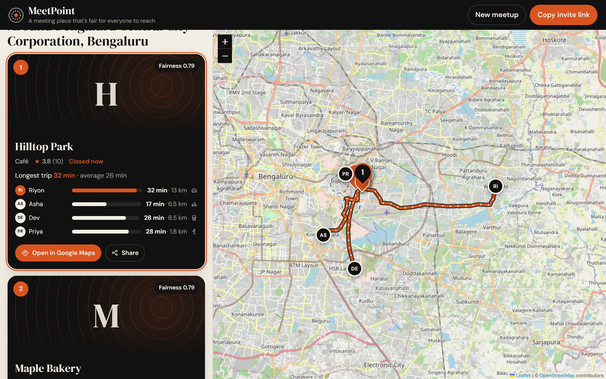
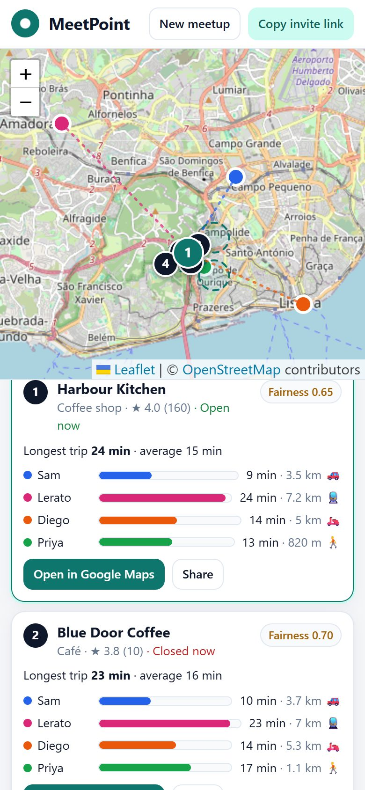

<p align="center"></p>

# MeetPoint

[](https://github.com/jyotiradityabordoloi-cyber/Meetpoint/actions/workflows/ci.yml)
[](LICENSE)


**Find a meeting place that is fair for everyone in a group to reach, in any city.**

<p align="center">
  
  &nbsp;
  
</p>
<p align="center"><sub>Screenshots use the demo server (<code>scripts/dev_fake_maps.py</code>). Place search, area names and journey paths are real OpenStreetMap data. Venue names, ratings and travel times are made up, and venue cards show a drawn placeholder where Google photos would go. With a Google Maps key you get real venues, photos and live travel times.</sub></p>

MeetPoint is a responsive web app. An organiser creates a meetup, people add where they're starting from (address, GPS or a pin on the map, or through an invite link), and **Find meeting point** returns five ranked venues. Each venue shows one bar per person on a shared time scale, so you can see straight away whether an option makes one person travel much longer than the rest.

The ranking is based on how long each person's trip takes, not on straight-line distance. It favours places where the longest trip is short and trip times are even across the group. It works wherever Google Maps Platform has coverage, with no per-city setup.

- Product requirements: [docs/prd.md](docs/prd.md)
- Phase-wise implementation plan: [docs/implementation.md](docs/implementation.md)

---

## How it works

```
Validate ─► Centre ─► Zones ─► Zone matrix ─► Score ─► Venues ─► Venue matrix ─► Rank top 5
2–25 people  geometric  20 points  per mode,       S = 0.5·max   Places Nearby   traffic-aware   0.7·norm(S)
             median     on 2 rings traffic-unaware   + 0.3·σ     800→1.5→3 km    meeting time    + 0.3·(1−Q)
             (sphere)                                + 0.2·mean
```

1. **Fair centre**: the geometric median of everyone's starting point, found with Weiszfeld's algorithm on the unit sphere. One person who lives far away doesn't pull it toward them the way an average point would. It also stays correct at any latitude and across the antimeridian.
2. **Candidate zones**: the centre, 6 points on a ring at r/2, 12 points on a ring at r, and the centroid, where `r = clamp(0.25 × group spread, 0.5 km, 10 km)`. The number of zones is reduced when needed so each route-matrix request stays within Google's limits (625 elements, or 100 for transit).
3. **Travel times**: one route-matrix request per travel mode in use. Zones that anyone can't reach (water, no service) are dropped.
4. **Fairness score**: `S = 0.5·max + 0.3·σ + 0.2·mean` in minutes, lower is better. Trips of 20/20/20 minutes score 14.0. Trips of 5/10/45 minutes (same total) score 31.8. The app also shows a fairness index, `1 − σ/mean`.
5. **Venues**: Places searches around the 3 fairest zones, which must be at least 0.4·r apart. When you ask for several kinds of place (for example restaurants, bars and pubs), the final five include the best of each kind before filling up by score. Venue quality is `Q = 0.6·(Bayesian rating/5) + 0.25·open-now + 0.15·closeness to the zone`, so a 5.0 rating from 3 reviews doesn't beat a 4.6 from 2,000.
6. **Final rank**: the 10 best venues get traffic-aware travel times for every person, then `Final = 0.7·normalised S + 0.3·(1 − Q)`. The 5 lowest are returned.

**Fallbacks** (it degrades rather than failing):

| Failure | What happens |
|---|---|
| No Google key | With `PHOTON_URL` set: real venues and area names from OpenStreetMap (no ratings or photos) and distance-based time estimates. Without it: fairest zones only |
| Routes API error | `distance × 1.3` at a typical speed for the mode; result marked *estimated* |
| Two-wheeler not offered in the country | Retried as driving, with a notice |
| No venues found or Places API error | Fairest zones shown instead |
| People more than 100 km apart | Warning; walking, cycling and transit switch to driving |

**Bounded cost per search** (single mode): 2 route-matrix requests (chunked if needed), at most 9 Places calls and 1 reverse geocode. The tests check these limits on every call.

## Tech stack

| Part | Technology |
|---|---|
| Web client | React 18, Vite 5, Leaflet 1.9 + react-leaflet 4, OpenStreetMap tiles |
| API | Python 3.12+, FastAPI, Pydantic v2, httpx (async) |
| Engine | `src/backend/app/services/engine.py`: plain Python, no HTTP or DB imports |
| Database | PostgreSQL 16 via SQLAlchemy 2 (SQLite for local dev) |
| External | Google Routes API, Places API (New), Geocoding API (server-side only) |

## Project layout

```
docs/                     PRD and implementation plan
src/
  backend/
    app/
      main.py             app factory, CORS, /health, start-up purge
      config.py           every tunable value, from env vars
      routers/            groups & members, meeting-point, geocode proxy
      services/
        geo.py            spherical geometry (haversine, Weiszfeld median, rings)
        engine.py         meeting-point pipeline, scoring, fallbacks
        google.py         async Routes / Places (New) / Geocoding client
        region.py         area, city, country, km vs miles
      purge.py            deletes groups older than the retention period
    tests/                geometry, engine (7 cities, 5 continents), Google client, API
    scripts/dev_fake_maps.py   run the API with an offline fake map client (UI dev only)
  frontend/
    src/App.jsx           state, invite link (?g=<id>), lazy group creation
    src/components/       GroupSettings, People, AddPerson, Results, MapView
    src/api.js, format.js fetch + error codes; units, colours, labels
  docker-compose.yml      postgres + api + web (nginx)
```

## Quick start (local)

Requirements: Python 3.12+ and Node 20+.

### 1. Backend

```bash
cd src/backend
python -m venv .venv
# Windows: .venv\Scripts\activate    macOS/Linux: source .venv/bin/activate
pip install -e ".[dev]"
cp .env.example .env        # then set GOOGLE_MAPS_API_KEY (optional, see below)
uvicorn app.main:create_app --factory --reload --port 8000
```

### 2. Frontend

```bash
cd src/frontend
npm install
npm run dev                 # http://localhost:5173/plan/ (proxies /api to :8000)
```

**No Google key yet?** The app still runs. With `PHOTON_URL` set it suggests real cafés, restaurants, bars, pubs, parks and malls from OpenStreetMap. Each suggestion has a name and address but no ratings or photos, and travel times are estimated from distance. To try the whole app locally, run the demo API (development only). It uses OpenStreetMap for place search, venues, area names and journey paths (Photon and OSRM), and finds your city from your IP address:

```bash
cd src/backend
python scripts/dev_fake_maps.py
```

### Google Maps Platform key

1. In Google Cloud, enable **Routes API** (travel times and journey paths), **Places API (New)** (venues, photos and search-as-you-type) and **Geocoding API** for a project with billing.
2. Create an API key and restrict it to those three APIs (and to your server's IPs in production).
3. Put it in `src/backend/.env` as `GOOGLE_MAPS_API_KEY=...`.

The key is only used on the server. The browser never sees it; address search goes through `/api/geocode`.

## Deploy for free

Vercel hosts the website, Render hosts the API and Neon hosts the database. All three deploy from GitHub on every push. Follow the step-by-step guide in **[docs/DEPLOY.md](docs/DEPLOY.md)**; the config is already in the repo (`render.yaml`, `src/frontend/vercel.json`).

## Docker (PostgreSQL + API + web)

```bash
cd src
GOOGLE_MAPS_API_KEY=your-key docker compose up --build
# open http://localhost:8080
```

Nginx serves the built frontend and forwards `/api` to the FastAPI container. The API runs as a non-root user.

## API

All errors use one shape: `{"detail": {"code": "ADDRESS_NOT_FOUND", "message": "..."}}`.

| Method & path | Body / query | Success | Errors |
|---|---|---|---|
| `POST /api/groups` | `name, travel_mode, meet_at?, venue_types[]` | 201 group | 422 |
| `GET /api/groups/{id}` | | 200 group with members | 404 `GROUP_NOT_FOUND` |
| `PATCH /api/groups/{id}` | any of `name, travel_mode, meet_at, venue_types` | 200 group | 404, 422 |
| `POST /api/groups/{id}/members` | `name`, `lat+lng` or `address`, `travel_mode?` | 201 member | 404, 422 `TOO_MANY_MEMBERS` / `ADDRESS_NOT_FOUND`, 502 `GEOCODER_FAILED`, 503 `GEOCODER_UNAVAILABLE` |
| `DELETE /api/groups/{id}/members/{mid}` | | 204 | 404 `MEMBER_NOT_FOUND` |
| `POST /api/groups/{id}/meeting-point` | | 200 recommendation | 422 `NOT_ENOUGH_MEMBERS` / `TOO_MANY_MEMBERS` / `NO_REACHABLE_AREA`, 429 `RATE_LIMITED` |
| `GET /api/groups/{id}/recommendations?limit=` | | 200 latest results | 404 |
| `GET /api/geocode?q=` | free text, any country | 200 up to 5 matches | 502, 503 |
| `GET /api/autocomplete?q=&lat=&lng=&session=` | 2+ characters; optional point to rank results near | 200 `{provider, suggestions[]}` | 502 `SEARCH_FAILED`, 503 `SEARCH_UNAVAILABLE` |
| `GET /api/places/{id}?session=` | a Google suggestion id | 200 `{label, lat, lng}` | 404 `PLACE_NOT_FOUND` |
| `POST /api/groups/{id}/journeys` | `lat, lng` of the venue | 200 `{provider, to, journeys[{member_id, mode, from, path, minutes, meters}]}`; `path` is null when no route (draw a curve) | 404, 422, 429 |
| `GET /api/photos?name=&w=` | a Places photo name from a result | 302 to the image | 404 `PHOTO_NOT_FOUND`, 422, 502 |
| `GET /api/locate` | | 200 `{located, lat, lng, city, country_code, source}` (city-level, rounded) | |
| `GET /health` | | `{ok, maps_configured, search}` | |

Travel modes: `DRIVE`, `TWO_WHEELER`, `TRANSIT`, `WALK`, `BICYCLE`. `meet_at` is ISO-8601 **with a UTC offset**, so viewers in any time zone read it correctly.

## Place search and approximate location

Typing in the starting-point box shows place suggestions after two letters. Results are ranked near the people already in the group or, for the first person, near the viewer's approximate location.

- **Search provider:** Google Places Autocomplete (New) when `GOOGLE_MAPS_API_KEY` is set. Keystrokes and the final pick share a session token, so they're billed as one session. Without a key, set `PHOTON_URL` to use [Photon](https://photon.komoot.io), free OpenStreetMap search. The public instance is fair-use only, so self-host it for real traffic. When Photon is down or slow, the API switches by itself to [Nominatim](https://nominatim.org) (place search, area names and venues) and then [Overpass](https://overpass-api.de) (venues), and skips Photon for five minutes before trying it again (`NOMINATIM_URL`, `OVERPASS_URL`; set either to empty to turn it off).
- **Approximate location** (`GET /api/locate`): city-level only, rounded to about 1 km, and never stored or logged. It also opens the map on the viewer's area instead of the whole world. Sources, in order:
  1. Location headers from the hosting edge: Cloudflare (turn on *visitor location headers*), Vercel or Google Cloud.
  2. A local MaxMind GeoLite2-City database (`GEOIP_DB_PATH`), so no third party sees the IP address.
  3. For local development only, `DEV_LOCATE_PUBLIC_IP=true`, which looks up the computer's own public IP address.

## Configuration

All settings are environment variables. See [src/backend/.env.example](src/backend/.env.example) for the full list with defaults: group limits, ring radius, fairness weights, venue radius steps, fallback speeds, retention days and rate limit. There is no default city, coordinate or country anywhere in the code.

## Tests

```bash
cd src/backend && pytest -q       # 79 tests: geometry, engine, Google client, search, IP location, journeys, photos, HTTP API
cd src/frontend && npm test       # formatting / units / time-zone helpers
```

The engine tests run the full pipeline in 7 cities on 5 continents against a fake map client. That client checks Google's route-matrix element limits on every call, so a change that would break them fails the tests. Every fallback and every edge case from the PRD has a test.

## Journeys, photos and design

- **Journey paths:** select a venue and the map draws each person's route to it. The route draws itself in, then small dots flow along it toward the venue. With a Google key the routes come from Google Routes (real roads and transit lines). Without one, set `OSRM_URL` for OpenStreetMap routing (car, bike, foot). Trips with no route are drawn as a smooth curve. Routes are fetched only when someone opens a venue, and are cached.
- **Venue photos:** up to three Google Places photos per venue, swipeable, with the photographer credited. They load through `/api/photos`, which redirects to Google's image URL, so the API key never reaches the browser.
- **Three colours:** cream `#f3eee3`, black `#111111` and burnt orange `#d9541e`, plus transparent shades of those three. The map tiles keep their normal colours. People are told apart by initials, the longest trip in each venue is orange, and every icon is a single-colour line icon. Headings use DM Serif Display, body text uses DM Sans.
- **Motion:** the draw-in, flowing dots, travel bars growing and the venue pulse all turn off when the system's *reduce motion* setting is on.

## Search and link previews

MeetPoint is a tool, not a content site. The landing page (`/`) and the planner (`/plan`) are meant to be found and shared. Meetup links contain people's starting points, so they must never show up in search results.

| What | How |
|---|---|
| Real content without JavaScript | The landing page (`public/index.html`) is static HTML. The planner (`plan/index.html`) has a heading, "How it works" and a `<noscript>` note. React replaces them once it loads. |
| Titles and description | A descriptive home-page title and meta description. A meetup tab shows `Friday dinner · MeetPoint`. |
| Link previews (WhatsApp, Slack, X, LinkedIn) | Open Graph and Twitter tags, plus a 1200×630 share image at `public/og-image.png` |
| Structured data | JSON-LD `WebApplication` |
| One heading, accessible names | A single `<h1>`. Actions that go somewhere are links (`Open in Google Maps`); actions that do something are buttons. |
| Meetup links kept private | `noindex, nofollow` as a meta tag (set by the app) and as an `X-Robots-Tag` header (set by nginx when `?g=` is present). The API sends `noindex` too. |
| No leaking via the Referer header | `Referrer-Policy: strict-origin-when-cross-origin`, so map tile and Google Maps requests never see a `?g=` id |
| Real 404s | nginx serves the app at `/` only. Unknown paths return a 404 status and `404.html`, not the app (which would be a "soft 404"). |
| robots.txt, sitemap, canonical | Generated at build time. Build with `VITE_SITE_URL=https://your-domain` to get `<link rel="canonical">`, an absolute share-image URL and `sitemap.xml`. AI crawlers are not blocked. |
| Icons | SVG favicon, Apple touch icon, a web manifest, and 192/512 px icons (the 512 is also maskable) |

At launch (outside the code):

1. Serve a single origin. Redirect `www` to the bare domain (or the other way) and HTTP to HTTPS at the load balancer.
2. Build with `SITE_URL=https://your-domain docker compose up --build`.
3. Add the domain to Google Search Console and Bing Webmaster Tools, and submit `/sitemap.xml`.
4. Check the share preview with a link-preview debugger, such as LinkedIn Post Inspector or by pasting the link into a chat.
5. Get a few links pointing to the site: this repo's "Website" field, a Product Hunt or Show HN post, and any city or community pages that would find it useful.

## Privacy

- Anyone with the invite link (an unguessable 48-bit id) can view and edit the group. There are no accounts in v1.
- Groups, with their members and saved results, are deleted after `GROUP_RETENTION_DAYS` (30 by default). This runs at API start-up, and `python -m app.purge` can be scheduled to run nightly.
- Coordinates and addresses are never written to logs.

## Status

Built: everything in the PRD's P0 and P1 scope, which is:

- meetup and invite link
- address, GPS or pin input
- travel mode per person
- the fair meeting-point engine
- venue suggestions
- travel strips and the map
- all fallbacks
- meeting time
- saved results

Also built from the production list: Docker, an in-process rate limit, the retention purge and CI.

Planned (see [docs/implementation.md](docs/implementation.md), phases 8–10):

- Alembic migrations
- a Redis cache for Places results
- a shared rate limiter for multiple instances
- a commercial map tile provider for heavy traffic
- request ids and metric dashboards
- the 20-city fairness benchmark
- v2: accessibility routing, opening hours at the meeting time, venue voting

## License

[MIT](LICENSE). Map data © OpenStreetMap contributors. Venue and routing data come from Google Maps Platform under Google's terms.
